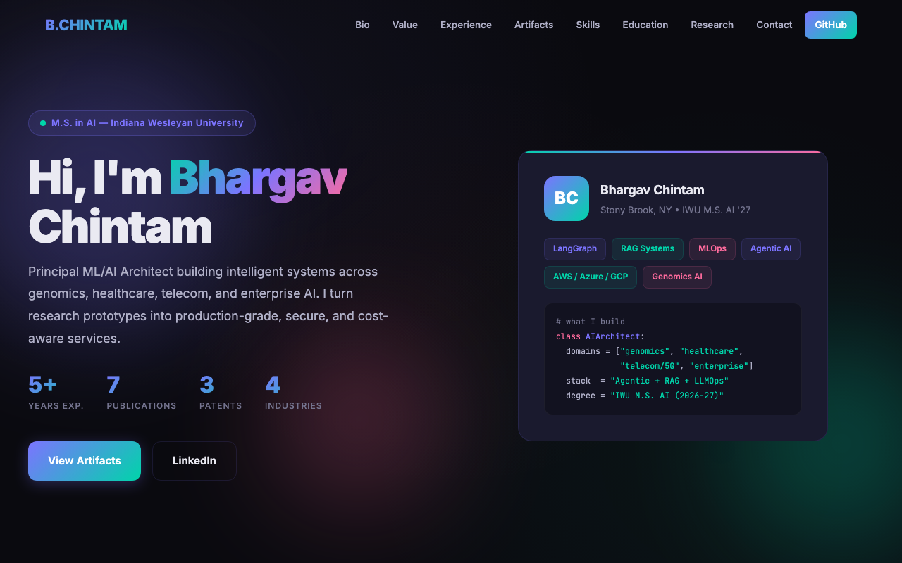
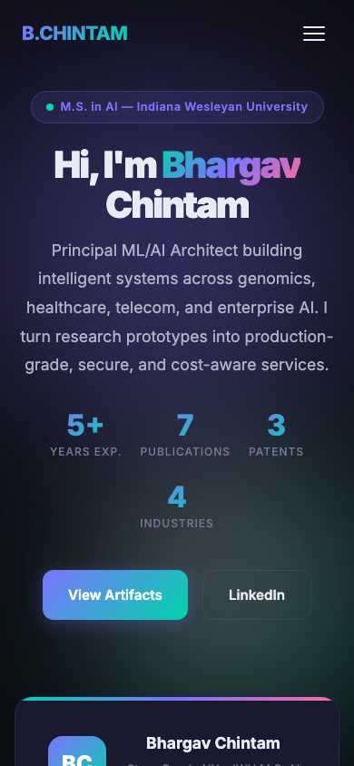

# Bhargav Chintam — AI/ML Professional Portfolio

This repository holds the e-portfolio website of Bindu Bhargava Reddy Chintam (Bhargav Chintam), an AI/ML professional. It is a single page with his bio, experience, skills, education, publications and contact details. The main section, **Portfolio Artifacts**, shows coursework from his M.S. in Artificial Intelligence at Indiana Wesleyan University (IWU), for example an interactive timeline of AI history, an audit of a healthcare AI assistant, a multi-agent research copilot design and a slide deck on how a neural network learns.

**Live site:** https://bhargavchintam.github.io/Portfolio/

## Screenshots

<table>
  <tr>
    <td width="76%" valign="top">
      
      <br>Desktop (1280 × 800)
    </td>
    <td width="24%" valign="top">
      
      <br>Phone (390 × 844)
    </td>
  </tr>
</table>

## How it is built

- The whole site is a single [`index.html`](index.html) file. The CSS and JavaScript are inline, and the only outside resource is Google Fonts. There is no framework and no build step.
- A few supporting files sit next to it: [`favicon.svg`](favicon.svg), [`artifacts/`](artifacts) (a standalone page for the machine learning algorithm types framework) and [`assets/`](assets) (the PDF, PPTX and image files that the AIML-501 artifacts link to).
- GitHub Pages serves the site. The workflow [`.github/workflows/static.yml`](.github/workflows/static.yml) deploys the repository to Pages on every push to `main`, and it can also be run by hand from the Actions tab.

## Run it locally

Open `index.html` in a browser, or serve the folder with Python so it behaves like the live site:

```bash
git clone https://github.com/bhargavchintam/Portfolio.git
cd Portfolio
python3 -m http.server 8000
```

Then visit http://localhost:8000/.

## License

[MIT](LICENSE)
